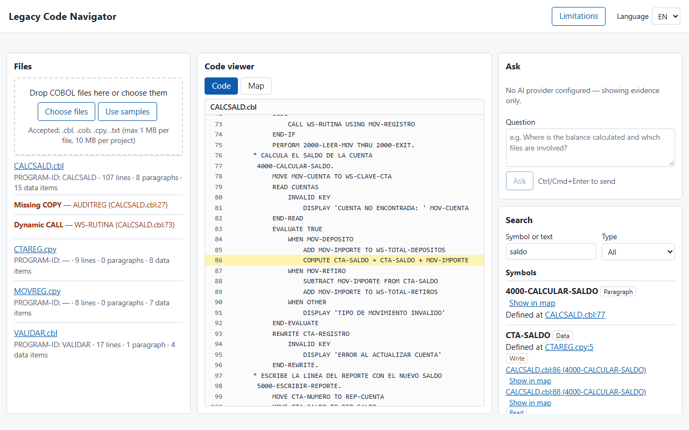
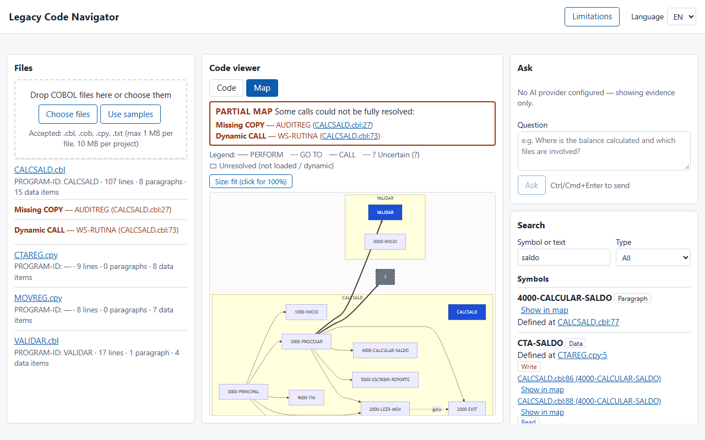
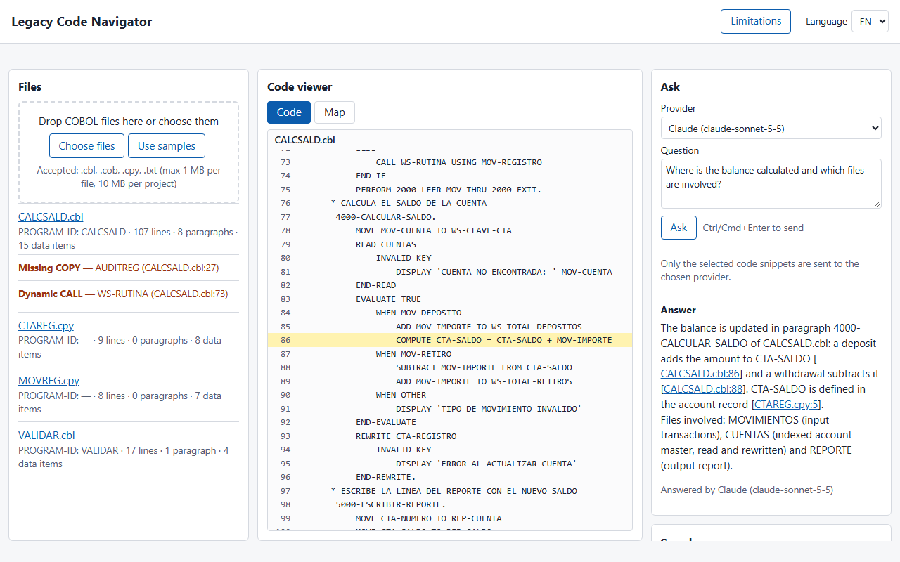

# Legacy Code Navigator

[](https://github.com/jacksonos/legacy-navigator/actions/workflows/ci.yml)

Explore COBOL programs before you change them. Load sources and copybooks, search symbols, ask questions
in natural language and get answers whose `file:line` citations are **verified against the code**, and
see the PERFORM / CALL map — flagged as **partial** whenever a dependency can't be resolved.

> *Explora programas COBOL antes de modificarlos: búsqueda por símbolo, preguntas en lenguaje natural con
> citas verificadas y mapa de llamadas que se marca como parcial cuando no se pueden resolver todas las
> dependencias. UI en inglés y español.*



## Features

- **Upload** `.cbl`, `.cob`, `.cpy` files (or use the bundled samples). Copybooks are expanded and every
  line keeps its original `file:line`.
- **Symbol search**: data items, paragraphs, sections, files and programs, with references classified as
  **write / read / I/O**, plus full-text matches (SQLite FTS5). Click any reference to jump to the line.
- **Call map** (Mermaid): PERFORM (incl. `THRU` ranges), `GO TO`, `CALL`, grouped by program. A
  **Partial map** banner lists exactly what couldn't be resolved: missing copybooks, dynamic `CALL`,
  programs not loaded, `ALTER`, `GO TO … DEPENDING ON`.
- **Ask**: "Where is the balance calculated and which files are involved?" → an answer from OpenAI,
  Claude or Gemini, grounded on retrieved paragraphs. Every citation is checked server-side; invented
  ones are removed and reported. Without an API key it still works in **evidence-only mode**.
- **EN / ES** interface.

| Call map with partial-map banner | Answer with verified citations (illustrative) |
|---|---|
|  |  |

## Quick start

```bash
cp .env.example .env        # optional: add one AI provider key + model
docker compose up -d --build
# open http://localhost:8080 and click "Use samples"
```

Or without compose:

```bash
docker build -t legacy-navigator .
docker run -p 8080:8080 -v navigator-data:/data -e ANTHROPIC_API_KEY=... legacy-navigator
```

## Configuration

| Variable | Purpose |
|---|---|
| `ANTHROPIC_API_KEY` + `ANTHROPIC_MODEL` | Enables Claude (model defaults to `claude-sonnet-5-5`) |
| `OPENAI_API_KEY` + `OPENAI_MODEL` | Enables OpenAI (model required) |
| `GEMINI_API_KEY` + `GEMINI_MODEL` | Enables Gemini (model required) |
| `ASK_MAX_CHARS` | Max characters of code sent per question (default 24000) |
| `DB_PATH` | SQLite file (default `./data/navigator.db`, `/data/navigator.db` in Docker) |
| `ADDR` | Listen address (default `:8080`) |

API keys live only in the server environment. Only the selected snippets are sent to the provider.

## How it works

```
React + Vite UI ──JSON──► Go (net/http) ── cobol/  fixed-format normalizer · COPY expansion · parser
                                        ── SQLite + FTS5  symbols · refs · edges · source lines
                                        ── ask     retrieve paragraphs → LLM → validate citations
                                        ── llm/    OpenAI | Anthropic | Gemini over plain HTTP
One static binary serves the API and the embedded UI → one distroless Docker image.
```

Retrieval is symbolic and deterministic (FTS5 + the parser's index), not vector search: COBOL has exact
identifiers, and the evidence sent to the model is always visible in the UI. Design decisions and
contracts: [docs/03-arquitectura.md](docs/03-arquitectura.md).

## Known limitations

- Fixed-format COBOL only; free format and `COPY … REPLACING` are reported, not supported.
- Question terms must appear in the code or its comments ("balance" won't find `WS-SALDO`).
- Qualified names (`X OF Y`) and `REDEFINES` are resolved by name; `EXEC SQL/CICS` is opaque (host
  variables only); one program per file.
- Projects are stored without expiry.

The same list is shown in the app (**Limitations** in the header).

## Development

Requires Node 22 and Go 1.25 (or Docker for Go).

```bash
# backend (or: docker run --rm -v "$PWD:/repo" -w /repo/server golang:1.25-alpine go test ./...)
cd server && go test ./... && go run .
# frontend (proxies /api to :8080)
cd web && npm ci && npm run dev
```

Project docs (Spanish): [vision & scope](docs/01-vision-y-alcance.md) ·
[requirements](docs/02-requisitos.md) · [architecture](docs/03-arquitectura.md) · [plan](docs/04-plan.md)
