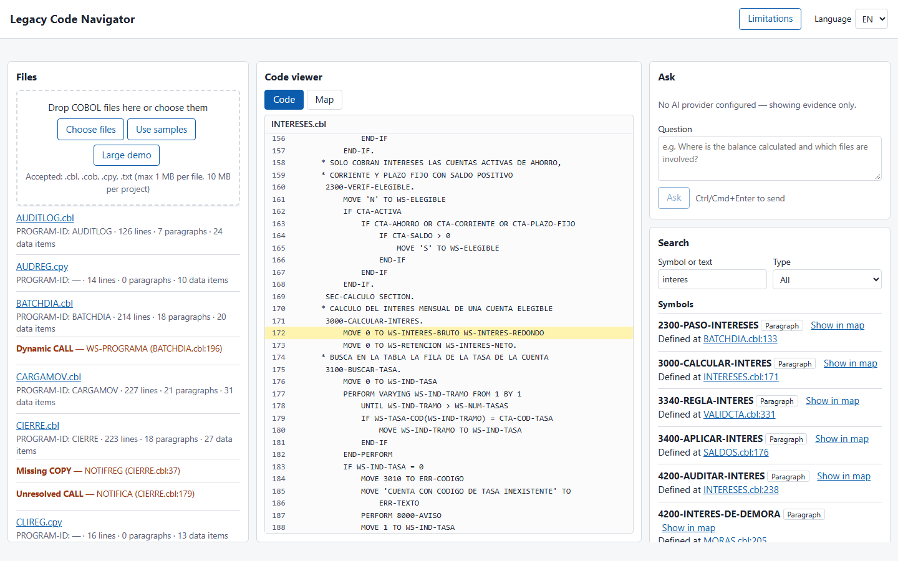
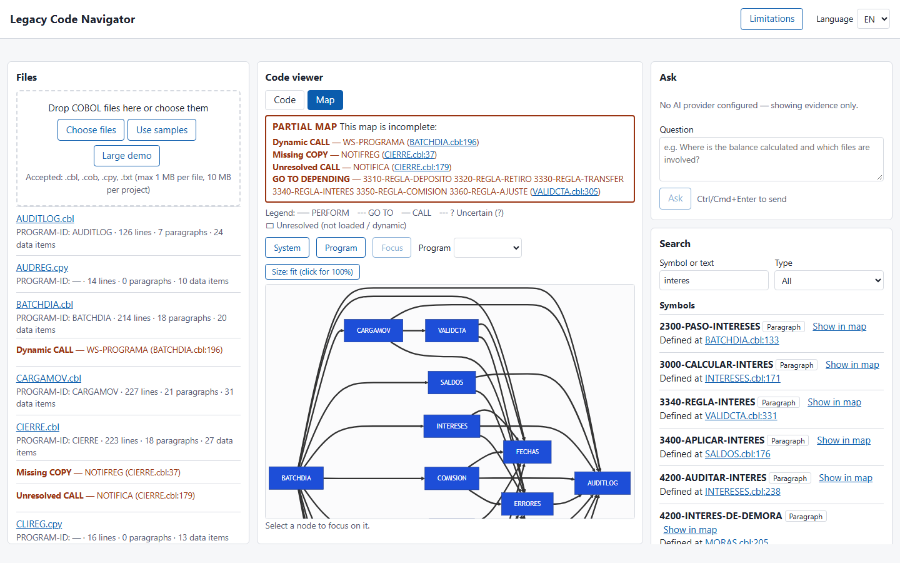
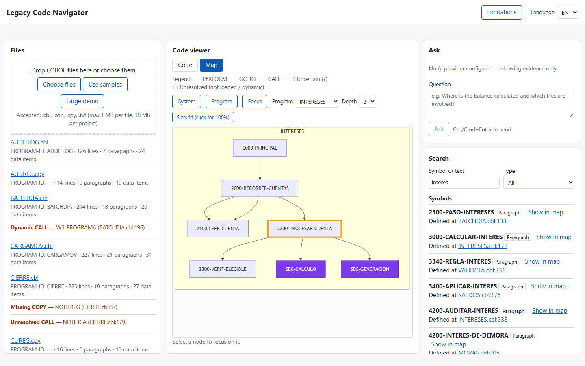
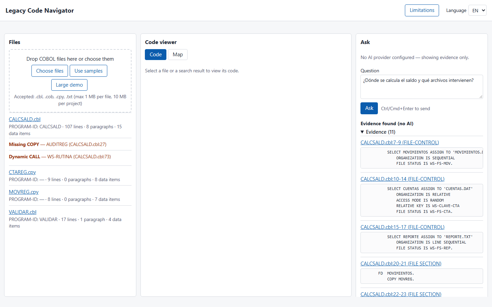
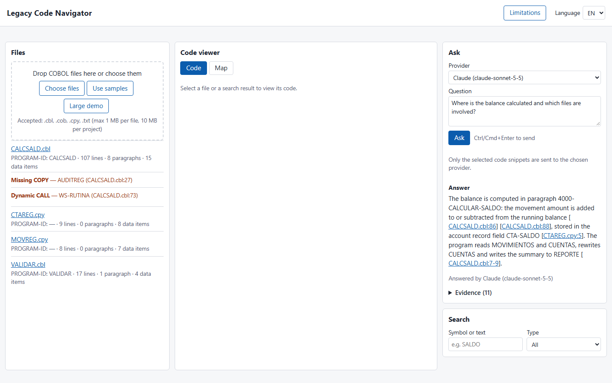
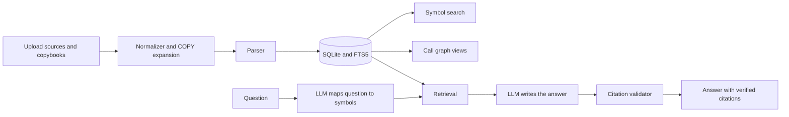

<div align="center">

# Legacy Code Navigator

**Understand a COBOL system before you change it, and trust every line the answer points to.**

[](https://github.com/jacksonos/legacy-navigator/actions/workflows/ci.yml)


[](LICENSE)

[Features](#features) · [Quick start](#quick-start) · [How it works](#how-it-works) · [Docs](#documentation)



</div>

## Why

Changing a COBOL program you did not write starts with hours of reading fixed-format source to answer basic
questions: where is this value computed, which files does it touch, who calls this paragraph. An LLM can answer
them in seconds, but only an answer you can check is safe to act on. Legacy Code Navigator indexes the code with a
purpose-built parser, retrieves evidence deterministically, and removes any `file:line` citation that does not
exist in the code before showing it.

> *Explora programas COBOL antes de modificarlos: búsqueda por símbolo, preguntas en lenguaje natural con citas
> verificadas y mapa de llamadas que se marca como parcial cuando no se pueden resolver todas las dependencias.
> Interfaz en inglés y español.*

## Features

| | |
|---|---|
| **Verified citations** | Every `file:line` in an answer is checked server-side against the code that was sent as evidence. Invalid ones are removed and listed as unverified. |
| **Evidence-only mode** | With no AI provider configured, the app still returns the relevant paragraphs, written symbols and I/O files. |
| **Four LLM providers** | Anthropic, OpenAI, Gemini and OpenRouter over plain HTTP, no SDKs. Pick one per question. |
| **Question to symbols** | With a provider, the question is first mapped to up to 15 symbol names that are validated against the index, so "balance" can find `WS-SALDO`. |
| **Scalable call map** | System, program and focus views, capped at 300 edges. Anything cut or unresolved is declared as a **partial map**. |
| **COBOL coverage** | Fixed and free format, `COPY … REPLACING`, several programs per file (consecutive or nested), every COBOL verb classified as read, write or I/O. |
| **Symbol search** | Data items, paragraphs, sections, files and programs, with references classified as write, read or I/O, plus FTS5 full-text over lines and comments. |
| **EN / ES interface** | Language follows the browser and is remembered. |
| **Easy to run** | One static Go binary serves the API and the embedded UI, packaged as a distroless Docker image. |
| **Self-cleaning** | Projects expire automatically (7 days by default). |

## Screenshots

| Call map, system view | Call map, focus view |
|---|---|
|  |  |
| 12 programs of the large demo with the partial-map banner listing what could not be resolved. | Neighbours within 2 hops of a paragraph; select a node to open its code or refocus. |

| Evidence-only mode | Answer with verified citations (illustrative) |
|---|---|
|  |  |
| The paragraphs, files and statements involved, found without any AI. | Illustrative: the answer text is canned and the screenshot was captured with a stubbed provider. The citations are real lines of the sample code. |

## Quick start

```bash
cp .env.example .env        # optional: add one AI provider key and model
docker compose up -d --build
# open http://localhost:8080 and click "Use samples" or "Large demo"
```

Without compose:

```bash
docker build -t legacy-navigator .
docker run -p 8080:8080 -v navigator-data:/data -e ANTHROPIC_API_KEY=... legacy-navigator
```

**Use samples** loads a small program with copybooks (one dynamic `CALL`, one missing `COPY`). **Large demo** loads a
12-program banking system (8 copybooks, 3 045 lines) to try the map views. Without any provider key the app runs in
evidence-only mode.

## Configuration

All settings are environment variables; none is required to start the app.

| Variable | Default | Purpose |
|---|---|---|
| `ANTHROPIC_API_KEY`, `ANTHROPIC_MODEL` | model `claude-sonnet-5-5` | Enables Claude |
| `OPENAI_API_KEY`, `OPENAI_MODEL` | model **required** | Enables OpenAI |
| `GEMINI_API_KEY`, `GEMINI_MODEL` | model **required** | Enables Gemini |
| `OPENROUTER_API_KEY`, `OPENROUTER_MODEL` | model **required** | Enables OpenRouter (e.g. `openai/gpt-4o`) |
| `ASK_MAX_CHARS` | `24000` | Max characters of code sent per question |
| `DB_PATH` | `./data/navigator.db` (`/data/navigator.db` in Docker) | SQLite file |
| `ADDR` | `:8080` | Listen address |
| `PROJECT_TTL` | `168h` | How long projects are kept (Go duration; `0` = never delete) |

A provider is enabled when its key **and** its model are set. API keys live only in the server environment, and
only the selected code snippets are sent to the provider.

### AI providers

| Provider | Key variable | Model variable | Default model |
|---|---|---|---|
| Anthropic | `ANTHROPIC_API_KEY` | `ANTHROPIC_MODEL` | `claude-sonnet-5-5` |
| OpenAI | `OPENAI_API_KEY` | `OPENAI_MODEL` | none (required) |
| Gemini | `GEMINI_API_KEY` | `GEMINI_MODEL` | none (required) |
| OpenRouter | `OPENROUTER_API_KEY` | `OPENROUTER_MODEL` | none (required) |

## How it works



Every normalized line keeps its original `file:line`, even when it comes from an expanded copybook, which is what
makes the citations checkable. Retrieval is symbolic and deterministic (FTS5 plus the parser's index), not vector
search: COBOL has exact identifiers, results are explainable, and the evidence sent to the model is always visible in
the UI. Design decisions and contracts: [docs/03-arquitectura.md](docs/03-arquitectura.md).

## API overview

| Method and path | Purpose |
|---|---|
| `POST /api/projects` | Upload files (multipart); `?samples=1` or `?samples=large` loads the bundled demos |
| `GET /api/projects/{id}` | Per-file summary and project warnings |
| `GET /api/projects/{id}/files/{name}` | Source lines of a file |
| `GET /api/projects/{id}/search?q=&kind=` | Symbols with definition and classified references, plus line matches |
| `GET /api/projects/{id}/graph?view=&program=&node=&depth=` | System, program or focus call graph with partial-map reasons |
| `POST /api/projects/{id}/ask` | Question in, answer with verified citations and evidence out |
| `GET /api/providers` | Configured providers |
| `GET /api/health` | Liveness check |

JSON contracts: [docs/03-arquitectura.md](docs/03-arquitectura.md#api).

## Project structure

```
server/                 Go module (net/http, no framework)
  cobol/                normalizer, COPY expansion, parser
  llm/                  Anthropic, OpenAI, Gemini, OpenRouter clients
  samples/              small demo (embedded)
  samples-large/        large banking demo (embedded)
  api.go  askapi.go     HTTP handlers
  ask.go  cite.go       retrieval and citation validator
  graph.go  store.go    call-graph views and SQLite store
web/                    React + TypeScript + Vite UI
docs/                   vision, requirements, architecture, plan (Spanish) and screenshots
.github/workflows/      CI
Dockerfile  docker-compose.yml  .env.example
```

## Development and testing

Requires Node 22 and Go 1.25 (or Docker for Go).

```bash
# backend (without Go: docker run --rm -v "$PWD:/repo" -w /repo/server golang:1.25-alpine go test ./...)
cd server && go test ./... && go run .

# frontend (dev server proxies /api to :8080)
cd web && npm ci && npm run dev
npm run lint && npm run build
```

CI (GitHub Actions) runs three jobs on every pull request: `server` (`gofmt`, `go vet`, `go test`), `web`
(`npm run lint`, `npm run build`) and `docker` (builds the image).

## Known limitations

The same list is shown in the app (**Limitations** in the header).

- Free format and `COPY … REPLACING` are supported; in free format, paragraph names must start with an indent below 4, and `REPLACING` matches whole words (no partial `:TAG:` idiom).
- In evidence-only mode (no provider), question terms must appear in the code or its comments ("balance" will not find `WS-SALDO`); with a provider, the question is first mapped to symbols.
- Qualified names (`X OF Y`) and `REDEFINES` are resolved by name only.
- `EXEC SQL` / `EXEC CICS` blocks are opaque: only host variables are extracted.
- Nested programs are analysed on their own: names declared `GLOBAL` in the parent are not visible in the child.
- The map is partial when calls or copybooks cannot be resolved.
- Only the selected code snippets are sent to the AI provider.
- Projects are deleted automatically after 7 days (configurable with `PROJECT_TTL`). There are no per-user quotas or rate limits.

## Roadmap

- Public demo on a small VPS behind HTTPS, with the image published to GHCR.
- Rate limiting on `/ask` and a spending cap on the provider key.

## Documentation

Project documents are in Spanish:
[vision and scope](docs/01-vision-y-alcance.md) ·
[requirements](docs/02-requisitos.md) ·
[architecture](docs/03-arquitectura.md) ·
[plan and status](docs/04-plan.md)

## License

[MIT](LICENSE) © 2026 jacksonos
